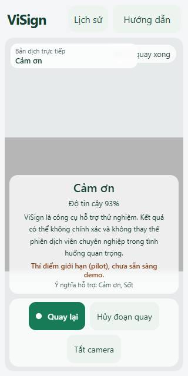
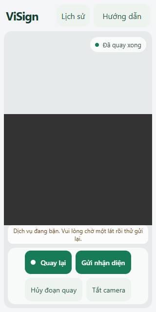
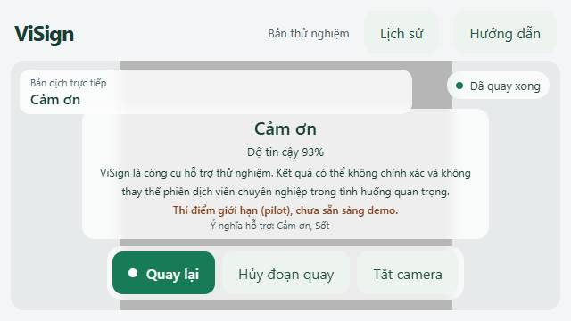
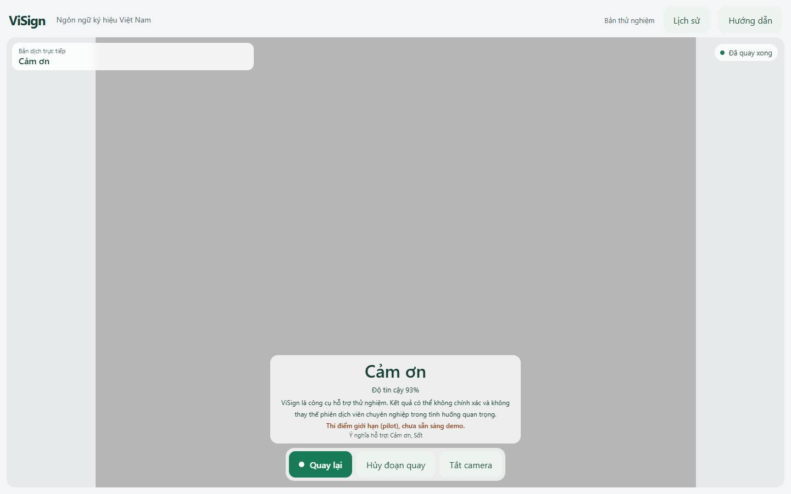

# ViSign · Báo cáo chất lượng FE/UI/UX (T088)

**Ngày**: 2026-11-08 · **Thực hiện**: trợ lý theo uỷ quyền P1/Huy (task của P5/Hiển, cần P5 review).
**Phương pháp**: chụp 6 trạng thái × 3 viewport bằng Playwright + Edge (camera giả, API giả lập theo contract),
xem trực tiếp từng ảnh; kết hợp kết quả T063 (`docs/verification-report.md`).

Tái lập: `cd apps/web; npm run build; $env:VISIGN_CAPTURE_SCREENSHOTS='<thư mục>'; $env:VISIGN_BROWSER_CHANNEL='msedge';
npx playwright test tests/accessibility/frontend-quality-screenshots.spec.ts` → 9 passed, 18 ảnh.

## Điểm tốt

- Một hành động chính rõ ràng ở mỗi bước (Bật camera → Quay ký hiệu → Kết thúc → Gửi nhận diện); không tự gửi.
- Kết quả hiển thị chữ lớn, độ tin cậy, disclaimer, cảnh báo phạm vi model (pilot) và danh sách nghĩa hỗ trợ.
- Kết quả bị từ chối gọn, có nút "Quay lại" ngay trong thẻ.
- Panel lịch sử nói rõ lưu cục bộ 24 giờ, có nút xoá; bản dịch trực tiếp nêu rõ "chưa phải câu dịch có ngữ pháp".
- Không cuộn ngang ở 320 px, 640×360 và zoom 200%; axe WCAG A/AA 0 vi phạm (T063).

## Phát hiện

| # | Mức | Vấn đề | Viewport | Đề xuất |
|---|---|---|---|---|
| 1 | Trung bình | Khung "Bản dịch trực tiếp" **đè lên badge trạng thái** camera; badge chỉ còn "…quay xong" | Mobile 320×640 (ảnh 1) | Xếp badge xuống dưới khung bản dịch hoặc thu hẹp khung ở màn hình hẹp |
| 2 | Thấp | Khung bản dịch chạm mép trên thẻ kết quả; thẻ kết quả che gần hết preview | Landscape 640×360 (ảnh 3) | Giảm chiều cao thẻ hoặc thu gọn disclaimer ở chiều cao nhỏ |
| 3 | Trung bình | Thông báo lỗi (ví dụ "Dịch vụ đang bận") là một dải chữ nhỏ ở đáy preview, kém nổi bật hơn thẻ kết quả | Mọi viewport (ảnh 2) | Dùng thẻ lỗi cùng kiểu thẻ kết quả, có tiêu đề và hành động "Gửi lại" rõ |
| 4 | Thấp | Sau khi có kết quả, badge vẫn ghi "Đã quay xong" | Mọi viewport | Thêm trạng thái "Đã có kết quả" |
| 5 | Thấp | Disclaimer và "Ý nghĩa hỗ trợ" cỡ chữ nhỏ trong thẻ kết quả | Mobile | Tăng cỡ chữ tối thiểu hoặc thu gọn còn một dòng + liên kết chi tiết |
| 6 | Thấp | Thời điểm lịch sử dạng `8/11/26` | Mọi viewport | Hiển thị `08/11/2026 01:23` |
| 7 | **Trung bình** | Camera chập chờn chuyển "Camera gặp lỗi" khi đang quay: 1/4 lượt chụp ảnh; bộ T063 hỏng 1–4/21 test mỗi lượt trên máy P1 | Mọi viewport, camera giả + Edge | Bắt sự kiện `error` của MediaRecorder và ghi tên lỗi; kiểm trên webcam thật (xem review T063) |

## Ảnh minh hoạ

1. Mobile — khung bản dịch đè badge trạng thái: 
2. Mobile — thông báo lỗi bận: 
3. Landscape — kết quả accepted: 
4. Desktop — kết quả accepted: 

## Ranh giới module FE

Component theo tính năng trong `apps/web/src/features/recognition/` (camera, kết quả, lỗi, bản dịch, lịch sử);
state tập trung ở `useRecognition.ts` (216 dòng); câu chữ tập trung ở `content/vi.ts`; transport ở
`services/inferenceApi.ts`. P5 bổ sung đánh giá chi tiết (cũng là phần FE của T090).

## Chưa kiểm

Webcam và điện thoại thật, ánh sáng/khoảng cách thật, người dùng thuộc nhóm mục tiêu (T071).
